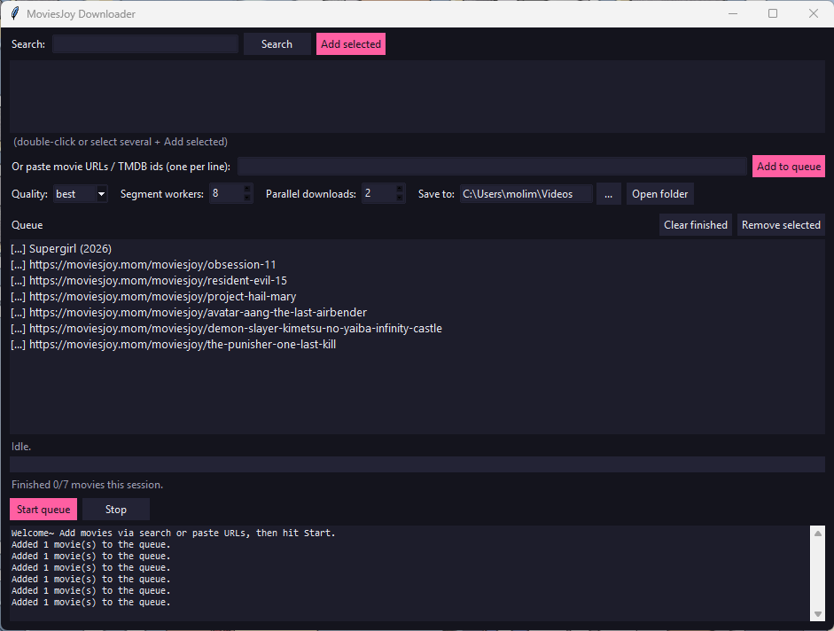

# MoviesJoy Queue Downloader



A small Windows desktop app (Python + Tkinter) that keeps a **bulk download queue**
for videos from streaming sites like [MoviesJoy](https://moviesjoy.mom) and saves
the **publicly served HLS stream** to a local, player-friendly MP4 file for
**personal, offline viewing**.

> This tool hosts, modifies, and distributes no content. It simply requests the
> same publicly accessible streams your browser already plays, then joins the
> segments into a single file on your machine. You are responsible for making
> sure your use complies with the site's terms of service and the law where you
> live. Please use it only for personal, non-commercial purposes.

## Features

- **Search built in** — look up a title on the site and add results straight to
  the queue (no need to hunt for page URLs)
- **Bulk queue** — paste multiple page URLs or TMDB ids, one per line
- **Up to 3 simultaneous downloads**, each with tunable parallel segment workers
- **Quality picker** — best / 1080 / 720 / 480 (nearest available stream)
- **Live progress** — per-item percentage, segment counter, and MB counter
- **Stop & resume** — cancel any item; the queue persists to `queue.json` and
  is restored on the next launch
- **Clean output** — segments are joined and muxed to MP4 with `faststart`,
  ready for phone/tablet/laptop playback (great for flights)

## How it works (short version)

For each queued item the app replays the same requests the site's own web
player makes: it resolves the video page to a TMDB id, follows the embedded
player chain, decrypts the stream manifest with the site's own per-time-window
WASM decryptor, obtains an access token, downloads the HLS segments in
parallel, and muxes them to MP4 with ffmpeg. Nothing is re-hosted.

## Requirements

| Requirement | Notes |
|---|---|
| **Python 3.9+** (3.10 tested) | From [python.org](https://www.python.org/downloads/) — keep the default options, which include Tkinter |
| **ffmpeg** on PATH | `winget install --id Gyan.FFmpeg` or grab a build from [ffmpeg.org](https://ffmpeg.org/download.html). Verify with `ffmpeg -version` (open a *new* terminal after installing) |
| **pip packages** | `pip install -r requirements.txt` (installs `requests` and `wasmtime`) |

## Install

```bash
git clone <this repo>
cd moviesjoy-downloader
pip install -r requirements.txt
```

## Run

GUI (no console window):

```bash
pythonw moviesjoy_gui.py
```

Optional: create a Windows shortcut to `pythonw.exe` with the script as the
argument, or use a one-line `.bat` file:

```bat
@echo off
start "" "C:\Path\To\pythonw.exe" "C:\Path\To\moviesjoy_gui.py"
```

### Using the GUI

1. **Search** a title and double-click a result (or multi-select and press
   *Add selected*), **or paste** page URLs / TMDB ids into the paste box.
2. Pick a **quality**, the number of **segment workers** (parallel connections
   per movie) and **parallel downloads** (movies at once), and a **save folder**.
3. Press **Start queue**. Watch per-item progress; press **Stop** to cancel.
4. Finished files land in your save folder. The queue is saved to
   `queue.json` and restored on the next launch.

## Command line

The core is also usable without the GUI:

```bash
python moviesjoy_dl.py "https://moviesjoy.mom/moviesjoy/<movie-page>" 
python moviesjoy_dl.py <tmdb-id> --quality 720 --workers 8 --out "D:\Movies"
python moviesjoy_dl.py <url> --quality list      # list available qualities
python moviesjoy_dl.py <url> --limit 10          # quick 10-segment test run
```

## Notes

- The tool targets the site's VidUp server chain. If a title isn't available
  there, it can't be queued by this app.
- `queue.json` (your personal queue state) is git-ignored and never committed.
- If a stream's access token expires mid-download, the app re-requests it
  automatically.

## License

MIT — see [LICENSE](LICENSE).
